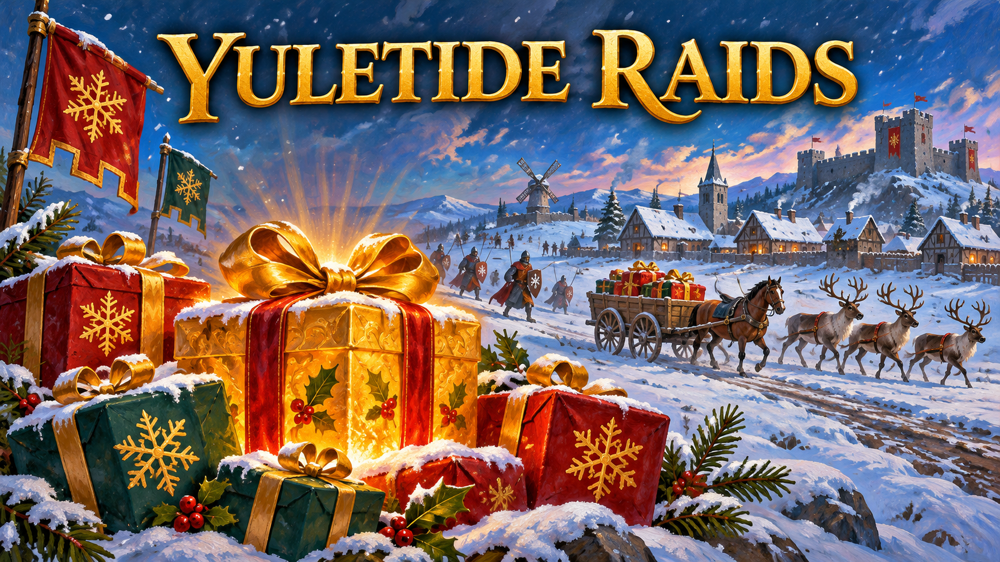

# Yuletide Raids

Father Christmas delivers presents across the map with an invulnerable reindeer convoy. Collect golden presents and spend them on elf raids against a chosen enemy, villagers or resources.

**Select Yuletide Raids as BOTH the game mode and tuning pack.** The game mode runs the events and shop; the tuning pack supplies the custom unit and present definitions. Both are supplied by this one extension archive. Start a new match after updating.

## Presents and convoy

- One Father Christmas trade cart per visit, with nine named reindeer. All ten are invulnerable, unselectable and controlled by the script, with zero sight and population. The convoy cannot collect its own gifts.
- The first visit begins after 60 seconds; later visits are 5–8 minutes apart. Each visit lasts 36 seconds and attempts up to ten drops. Native pathfinding and movement animations are used.
- Bring an eligible unit near a present to open it. Twenty percent are golden presents stored in your wallet.
- Ordinary presents give one of four equally likely outcomes: 300 gold to the opener, 300 gold shared among living enemies, a gold deposit, or a stone deposit.

## Golden-present shop

Only choices for your **current age** appear. Server checks reject purchases from other ages. Raid units have their age's configured health, armour and weapon upgrades; they are smaller than normal units. Waves use neutral ownership and do not reveal the enemy base to the buyer. There are no automatic elf raids.

| Option | Age I | Age II | Age III | Age IV |
|---|---:|---:|---:|---:|
| Resources per golden present | 300 | 450 | 600 | 900 |
| Villagers per golden present | 2 | 3 | 4 | 5 |
| Archer wave size | 3 | 4 | 5 | 6 |
| Spearman wave size | 4 | 6 | 8 | 10 |
| Armoured wave size | 2 | 3 | 4 | 5 |
| Golden-present cost per wave | 1 | 2 | 3 | 4 |

Villagers match the buyer's civilization and respect population limits. Failed wave deployments refund their purchase.

## Installation and source build

[Subscribe through the Age of Empires IV mod catalogue](https://www.ageofempires.com/mods/details/583206/), or search for **Yuletide Raids** by **TypeEkcyall** in the game.

Download `Yuletide_Raids.sga` from [Releases](https://github.com/TypeDan/Yuletide-Raids/releases). Put it in a `Yuletide Raids` folder inside your AoE IV user-data `mods/extension/local` directory. Select it in **both** lobby selectors: Game Mode and Tuning Pack.

To build from source, open `Yuletide Raids.aoe4mod` in the AoE IV Content Editor and choose **Build Mod (F7)**. The archive is written under `archives/`. Close the editor before launching the game on the Xbox/Store installation.

## Experimental status

Built against game version **17.0.12260**. Automated checks cover age restrictions, rewards, refunds, neutral raid deployment, all twelve unit variants, convoy invulnerability/movement/cleanup and pickup exclusions. Live tests have shown Age I melee and ranged attacks, reindeer running, the shop panel and ordinary-present collection. Scots and Vikings blueprint support is included.

A complete natural golden-present pickup → purchase → enemy attack sequence, all higher-age animations, deposit mining, multiplayer and save/load still need full in-game validation. Convoy spacing and route access can vary by map, and the cart horse's animation has not been separately confirmed close up.

The current build uses a native trade cart, reindeer, smaller human soldiers and native present models. Custom sleigh/Santa models, reliable red/green recolours, festive voices/bells and turkey replacements are **not implemented**. Golden presents are larger and labelled, without a gold repaint. The cover is promotional illustration, not a screenshot of custom assets.

## Credits

Uses the match setup, settings, victory-condition, diplomacy and civilization helper code from More Advanced Game Settings, based on [Woprok's original Advanced Game Settings](https://github.com/Woprok/AOE4-AdvancedGameSettings) and [Joshua Sachtleben's continuation](https://github.com/joshuasachtleben/AOE4-AdvancedGameSettings). The Christmas convoy, present rewards, golden-present shop and elf raids were added for Yuletide Raids. See [CREDITS.md](CREDITS.md) and the retained [GPL-3.0 license](LICENSE.md).
