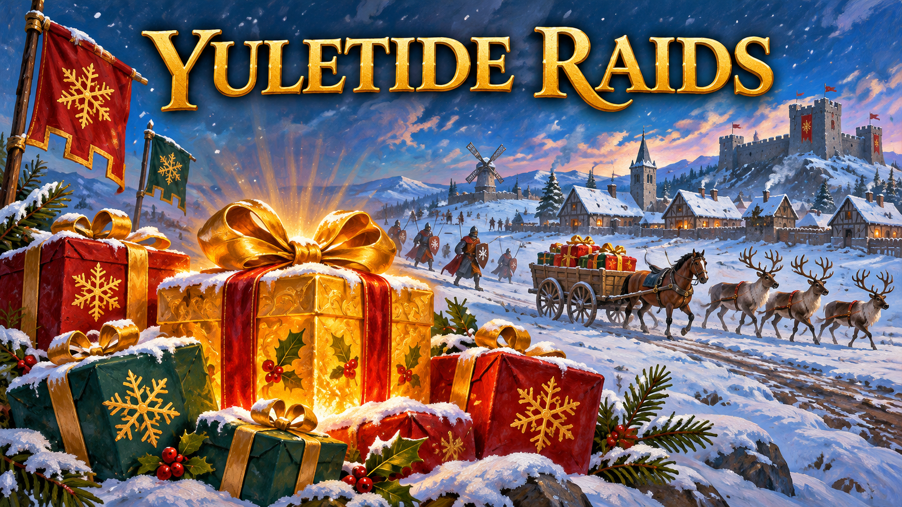

# Yuletide Raids

**Release version: 2026.11.20.3.** This label also appears at the start of the mod description.

Father Christmas drops presents across the map. Spend golden presents on elf raids, villagers or resources, with options for each age.

**Select Yuletide Raids as BOTH the game mode and tuning pack.** The game mode runs the events and shop; the tuning pack supplies the custom unit and present definitions. Both are supplied by this one extension archive. Start a new match after updating.

**Version 2026.11.20.3** reconnects presents to Santa: gifts appear beside his actual cart position as he follows his random route. Spacing checks prevent clustered drops, including after earlier gifts are collected. See [delivery validation](docs/2026-11-20-santa-delivery.md).

**Version 2026.11.20.2** explicitly removes Festive Cheer's movement and gathering bonuses at the end of its 30-second timer. Repeat purchases refresh the timer without stacking. See [expiry fix and validation](docs/2026-11-20-cheer-expiry.md).

The population and compact shop fixes from **2026.11.20.1** remain included: a configured maximum of 250 preserves normal house requirements, and the shop has centered equal-width tabs and aligned numeric costs. See [housing validation](docs/2026-11-20-housing-update.md).

## Presents and convoy

- One Father Christmas trade cart per visit, with nine named reindeer. All ten remain neutral throughout the visit, invulnerable and unselectable, with zero sight and population. No player owns or tracks the convoy. Native movement orders are queued before ownership is relinquished in the same simulation callback. The convoy cannot collect its own gifts.
- The first visit is due at **5:00**; later visits are due 5–8 minutes after the previous visit began. Each visit chooses a target of **8–12 presents**, with at least 6–9 seconds between drops. Visits last at least 36 seconds and continue until their target is delivered. Every drop is separated from earlier sites and other unopened presents by a map-scaled distance (24–80 world units). Collected gifts remain in the visit’s spacing history. Every gift appears beside Santa at his actual position, within six world units even after native spawn adjustment. If he is too close to an earlier drop or the ground is blocked, delivery waits for a suitable spot farther along his route. The convoy is not relocated to distribute gifts. You can follow him, but he must travel far enough between gifts to satisfy the spacing checks. A visit waits if fewer than eight slots remain under the limit of 24 unopened presents, then starts once enough are collected or expire. Uncollected presents expire after ten minutes. Native pathfinding and movement animations are used.
- Each visit starts at a random land location and follows random destinations across the map. Presents follow that same physical route and appear beside the moving cart. Player bases, team sizes and lobby order do not determine the route. Drops avoid water, buildings and nearby presents; a safety margin keeps the convoy away from the map boundary.
- Bring an eligible unit near a present to open it. **Forty percent** are golden presents stored in your wallet.
- Ordinary presents give 300 gold split between the opener and living teammates (40%), 300 gold shared among living enemies (40%), a gold deposit (10%), or a stone deposit (10%). These chances apply to the remaining 60% of presents that are not golden shop tokens. Deposits are placed on nearby clear ground after checking units and map objects; if no safe spot is found, the reward becomes shared team gold.

## Golden-present shop

Only choices for your **current age** appear. Server checks reject purchases from other ages. Raid units have their age's configured health, armour and weapon upgrades; they are smaller than normal units, with a 20% health and 10% base weapon-damage bonus above those age-specific values. Waves use neutral ownership and do not reveal the enemy base to the buyer. There are no automatic elf raids.

| Option | Age I | Age II | Age III | Age IV |
|---|---:|---:|---:|---:|
| Resources per golden present | 300 | 450 | 600 | 900 |
| Villagers per golden present | 2 | 3 | 4 | 5 |
| Archer wave size | 3 | 4 | 5 | 6 |
| Spearman wave size | 4 | 6 | 8 | 10 |
| Armoured wave size | 2 | 3 | 4 | 5 |
| Golden-present cost per wave | 1 | 2 | 3 | 4 |

All purchased resources, including gold, go entirely to the buyer. Gold found in ordinary presents is shared with living teammates. Villagers match the buyer's civilization and respect population limits. Failed wave deployments refund their purchase.

The **Buffs** tab includes **Festive Cheer**, costing **1 golden present** in any age. For **30 game seconds**, the buyer's villagers move **30% faster** and gather food, wood, gold and stone **50% faster**. Existing and newly trained villagers benefit; other players and non-villager units do not. The tab shows the remaining time. Buying again resets the timer to 30 seconds without stacking the effect. The buff multiplies existing economy bonuses, and those bonuses remain after it expires. A failed activation refunds the purchase.

The enemy selector shows player names, cycling in lobby-slot order. Duplicate names include a small slot suffix; long names are shortened visually, with the full name available on hover. Purchases still use stable lobby-slot IDs, so renamed players and empty slots do not redirect raids.

Small text with no background or border just above the bottom-left resource box shows your applied economy/military boosts and the game's population limit on separate rows: Eco, Military, then Pop. It is hidden when you have no custom bonuses. Pending boosts or a population mismatch appear in amber; `Pop 200 / 250`, for example, means the game currently reports 200 while the configured limit is 250. This display is also included in More Advanced Game Settings.

## Installation and source build

[Subscribe through the Age of Empires IV mod catalogue](https://www.ageofempires.com/mods/details/593852/), or search for **Yuletide Raids** by **TypeEkcyall** in the game. Check for version **2026.11.20.3** in the description and start a new match after updating.

Download `Yuletide_Raids.sga` from [Releases](https://github.com/TypeDan/Yuletide-Raids/releases). Put it in a `Yuletide Raids` folder inside your AoE IV user-data `mods/extension/local` directory. Select it in **both** lobby selectors: Game Mode and Tuning Pack.

To build from source, open `Yuletide Raids.aoe4mod` in the AoE IV Content Editor and choose **Build Mod (F7)**. The archive is written under `archives/`. Close the editor before launching the game on the Xbox/Store installation.

### Updating the published mod

1. Edit this existing project and keep its project ID unchanged. Back up or commit the changes.
2. With AoE IV closed, build in Content Editor with **F7** and check for build errors. Copy the resulting `archives/Yuletide_Raids.sga` into `Documents/My Games/Age of Empires IV/mods/extension/local/Yuletide Raids/` if the build has not deployed it there. Include the thumbnail alongside it.
3. Close Content Editor, launch AoE IV and test a new match with Yuletide selected as both Game Mode and Tuning Pack.
4. Open **Mods → My Mods → Mod Publisher**. Select the existing local project and publish its update. Confirm completion and check the existing catalogue entry's version and downloaded archive.
5. Keep the source and release on GitHub in sync. After checking the subscribed archive, enable only the published copy of Yuletide. Keep any local publishing copy disabled, and retain the source project and build archives outside the game's mod folders.

Keep this project's GUID unchanged for updates; a genuinely separate mod needs a different GUID. The [official publishing guide](https://support.ageofempires.com/hc/en-us/articles/4416968609044-Publishing-and-Using-Mods) describes updating the existing local project. The game failed to associate the rebuilt archive with the existing listing on 20 November and created a fresh listing. Deletion is not a routine update step. If the publisher shows Unknown or Publish Mod unexpectedly, check the existing listing before proceeding; the website's separate version counter is not this release label.

## Experimental status

The 20 November release was built with the native Content Editor for game version **17.0.12303**, with zero build errors or warnings. Automated checks cover age restrictions, rewards, refunds, neutral raid deployment, all twelve unit variants, convoy invulnerability/movement/cleanup and pickup exclusions. Live tests have shown Age I melee and ranged attacks, reindeer running, the shop panel and ordinary-present collection. Scots and Vikings blueprint support is included.

A complete natural golden-present pickup → purchase → enemy attack sequence, all higher-age animations, deposit mining, multiplayer and save/load still need full in-game validation. Available gift sites and convoy route access can vary by map, and the cart horse's animation has not been separately confirmed close up.

The current build uses a native trade cart, reindeer, smaller human soldiers and native present models. Custom sleigh/Santa models, reliable red/green recolours, festive voices/bells and turkey replacements are **not implemented**. Golden presents are larger and labelled, without a gold repaint. The cover is promotional illustration, not a screenshot of custom assets.

## Credits

Uses the match setup, settings, victory-condition, diplomacy and civilization helper code from More Advanced Game Settings, based on [Woprok's original Advanced Game Settings](https://github.com/Woprok/AOE4-AdvancedGameSettings) and [Joshua Sachtleben's continuation](https://github.com/joshuasachtleben/AOE4-AdvancedGameSettings). The Christmas convoy, present rewards, golden-present shop and elf raids were added for Yuletide Raids. See [CREDITS.md](CREDITS.md) and the retained [GPL-3.0 license](LICENSE.md).

## Release numbering

Use `YYYY.MM.DD.N` in `VERSION`, the description entries (IDs 2 and 3) in `assets/locdb/*.csv`, and the GitHub release. Increase `N` for each further release that day. Set the label before the native F7 build, publish through the existing local project, then verify the store description and downloaded archive. The site's own version counter is separate from this release label. Keep project GUIDs and existing store listings when updating; deleting listings is not a normal update step.
